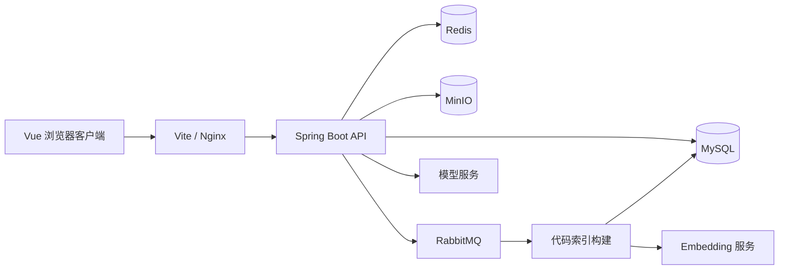

# CodeHub

代码仓库管理与代码问答平台，基于 Spring Boot 和 Vue 3 构建。支持创建公开或私有仓库、上传与浏览源码，以及结合仓库内容进行问答。

项目围绕文件上传、权限控制和索引构建展开：文件交给 MinIO 保存，元数据存入 MySQL，索引任务通过 RabbitMQ 派发，Redis 用于缓存、请求防重和分布式协调。

## 功能

| 模块 | 内容 |
| --- | --- |
| 账号与权限 | 注册、登录、退出、JWT 鉴权，按仓库可见性和成员身份检查访问权限 |
| 仓库管理 | 创建与删除仓库、分页列表、公开仓库浏览 |
| 文件管理 | 普通上传、分片上传、文件列表、内容查看、下载和删除 |
| 在线阅读 | Monaco Editor 代码展示、文本视图、文件搜索 |
| 代码问答 | 代码切分、向量检索与关键词回退、NDJSON 答案流、问答历史 |
| 后台管理 | 用户角色与状态、仓库管理、模型配置、操作审计和统计 |

这里的仓库用于管理文件和代码上下文，尚未接入 Git 的 clone、push、分支或合并协议。

## 技术栈

| 层次 | 选型 |
| --- | --- |
| 前端 | Vue 3、TypeScript、Vite、Element Plus、Pinia、Monaco Editor |
| 后端 | Spring Boot 3.2、MyBatis-Plus、JWT、BCrypt、Spring AOP |
| 数据与缓存 | MySQL 8、Redis 7、Caffeine、Redisson |
| 文件与消息 | MinIO、RabbitMQ |
| 接口文档 | Springdoc、Knife4j |

## 系统结构



前端请求统一使用 `/api` 前缀，由开发代理或 Nginx 转发并去掉前缀。后端 Controller 路径本身不包含 `/api`。

### 文件上传

前端对较大的文件按 1 MiB 分片。服务端记录上传会话、所属用户、仓库和分片数量，并通过唯一约束和会话锁协调分片写入与合并。合并前检查分片序号和实际字节数，再按顺序写入临时文件，上传到 MinIO。

数据库保存合并结果回执；同一会话重复提交合并请求时返回已有结果。索引任务在文件事务提交后派发，支持 RabbitMQ 异步处理及发送失败时的同步尝试。

### 代码问答

上传后的文本按类、方法等规则切分，提取代码内容、名称、导入信息和路径特征。配置嵌入服务后，可按向量相似度选择上下文；未配置或检索不可用时回退到关键词查询。上下文随问题发送给模型，答案以 NDJSON 逐行返回。

### 请求防重

`@Idempotent` 切面将用户和请求参数生成稳定摘要，通过 Redis 占位拦截防重窗口内的重复请求。占位值使用独立令牌，异常释放时以 Lua 检查归属，避免删除其他请求的占位。

## 目录

```text
CodeHub/
├── codehub-server/
│   ├── src/main/java/com/codehub/
│   │   ├── controller/     # HTTP 接口
│   │   ├── service/        # 业务逻辑与上传链路
│   │   ├── ai/             # 代码切分、模型和嵌入客户端
│   │   ├── aspect/         # 请求防重等切面
│   │   ├── entity/         # 数据实体
│   │   └── mapper/         # 数据访问
│   ├── src/test/           # 单元与集成测试
│   └── sql/               # 初始化与迁移脚本
├── codehub-web/            # Vue 前端
├── docs/                   # 设计说明与测试记录
├── scripts/                # 本地环境辅助脚本
└── docker-compose.yml      # 应用与基础设施配置
```

## 本地运行

需要 JDK 21、Maven 3、Node.js 22.12 或更高版本，以及 Docker Compose。后端编译目标为 Java 17，本地运行和 Docker 镜像使用 JDK 21。

以下命令从仓库根目录执行，分别启动基础设施、后端和前端。

### 1. 启动基础设施

```bash
docker compose up -d mysql redis minio rabbitmq
```

| 服务 | 本机端口 |
| --- | --- |
| MySQL | 3307 |
| Redis | 6379 |
| MinIO API / 控制台 | 9000 / 9001 |
| RabbitMQ AMQP / 管理台 | 5672 / 15672 |

首次使用空 MySQL 数据卷时会执行 [init.sql](codehub-server/sql/init.sql)。已有数据库升级前，先备份并检查表结构，再按 [上传会话迁移脚本](codehub-server/sql/migrations/001_upload_sessions.sql) 执行；新库不需要重复执行该迁移。

Compose 中的账号配置用于本地开发。已有同名容器或持久化卷时，应沿用其原有项目和数据卷配置。

### 2. 启动后端

```bash
mvn -f codehub-server/pom.xml -DskipTests package
java -jar codehub-server/target/codehub-server-1.0.0.jar
```

后端默认监听 `8080`。常用配置通过环境变量传入：

| 变量 | 用途 |
| --- | --- |
| `DB_HOST`、`DB_PORT`、`DB_USERNAME`、`DB_PASSWORD` | MySQL 连接 |
| `REDIS_HOST` | Redis 地址 |
| `RABBITMQ_HOST`、`RABBITMQ_USERNAME`、`RABBITMQ_PASSWORD` | RabbitMQ 连接 |
| `MINIO_ENDPOINT`、`MINIO_ACCESS_KEY`、`MINIO_SECRET_KEY`、`MINIO_BUCKET` | 对象存储 |
| `JWT_SECRET` | 登录令牌签名密钥 |
| `LLM_BASE_URL`、`LLM_API_KEY`、`LLM_MODEL` | OpenAI 兼容的聊天模型接口 |
| `EMBEDDING_URL`、`EMBEDDING_KEY`、`EMBEDDING_MODEL` | 嵌入接口 |

完整默认值见 [application.yml](codehub-server/src/main/resources/application.yml)。未配置模型时，可先使用账号、仓库和文件功能；代码问答需有效的聊天模型配置。嵌入配置独立于聊天模型。

### 3. 启动前端

在另一个终端执行：

```bash
cd codehub-web
npm ci
npm run dev
```

打开 [http://localhost:5173](http://localhost:5173)，注册账号后即可创建仓库和上传文件。接口文档位于 [http://localhost:8080/doc.html](http://localhost:8080/doc.html)。

仓库内的 [start-local.ps1](scripts/start-local.ps1) 用于维护者已有的 Windows 环境，包含固定工具路径并禁用真实模型调用；首次部署建议使用上面的常规步骤。

## 接口入口

下表是直接访问后端时的路径；经过前端代理访问时在路径前加 `/api`。业务接口按权限要求携带 `Authorization: Bearer <token>`。

| 方法 | 路径 | 作用 |
| --- | --- | --- |
| POST | `/auth/register`、`/auth/login` | 注册、登录 |
| GET | `/auth/me` | 当前账号 |
| POST | `/repos` | 创建仓库 |
| GET | `/repos/my`、`/repos/public` | 仓库分页列表 |
| POST / GET | `/repos/{repoId}/files` | 上传文件、文件列表 |
| GET | `/repos/{repoId}/files/{fileId}/content` | 文件内容 |
| GET | `/repos/{repoId}/files/{fileId}/download` | 获取下载地址 |
| POST | `/repos/{repoId}/files/chunks` | 上传分片 |
| POST | `/repos/{repoId}/files/chunks/merge` | 合并分片 |
| POST | `/ai/repos/{repoId}/ask` | 流式代码问答 |
| GET | `/ai/repos/{repoId}/history` | 问答历史 |

## 测试与构建

不依赖外部服务的防重、上传编排和索引派发测试：

```bash
mvn -f codehub-server/pom.xml -Dtest=IdempotencyKeyGeneratorTest,IdempotentAspectTest,ChunkUploadServiceTest,FileIndexDispatcherTest test
```

其余集成测试需要实际的数据库、Redis 等服务；运行前检查测试类中的连接配置，使用独立测试环境。

```bash
mvn -f codehub-server/pom.xml test
```

前端生产构建：

```bash
cd codehub-web
npm run build
```

## 实现范围

- 代码切分采用正则和括号层级规则，尚未使用编译器 AST。
- 自动索引目前处理不超过 1 MiB 的支持格式文本；大文件仍可保存和下载。
- MySQL 与 MinIO 不共享事务；索引派发尚未采用事务发件箱，跨服务失败仍需补偿与对账。
- 向量检索在应用内计算有限候选集的相似度，适用于小型仓库；更大规模需专门的检索索引。

## 设计文档

- [接口防重切面](docs/接口防重切面原理与升级.md)
- [分片上传与索引处理](docs/分片上传合并与索引可靠性升级.md)
- [本地环境与联调](docs/本地运行环境恢复与实测验收.md)
- [浏览器测试与分页代理](docs/浏览器验收与分页代理修复.md)
